**Note:** Built 100% with AI. I used AI to build this for me, and it is shared here in case it is useful to someone else.

# indexRouter

An Android companion for the **Pebble Index 01** ring. Click-hold or
double-click-hold the ring, say what you want, and indexRouter files it where
it belongs: a note in your Obsidian vault, a task, a timer, a calendar event,
or text for your keyboard to type. Both gestures can file into one vault, or
each into a vault of its own.

<a href="https://apps.obtainium.imranr.dev/redirect?r=obtainium://app/%7B%22id%22%3A%22org.snrkl.indexrouter%22%2C%22url%22%3A%22https%3A%2F%2Fgithub.com%2Fsnrkl-labs%2FindexRouter%22%2C%22author%22%3A%22snrkl-labs%22%2C%22name%22%3A%22indexRouter%22%7D"></a>

It works through the Pebble app's **webhook** feature. The Pebble app records
and transcribes. indexRouter receives the result on the phone itself, matches
the opening words against a keyword routing table you edit, and acts on it.

**Everything stays on the phone.** The receiver binds `127.0.0.1` only, every
request must carry a shared secret, and nothing is sent anywhere else.

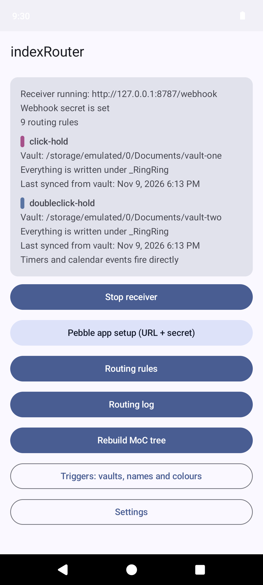 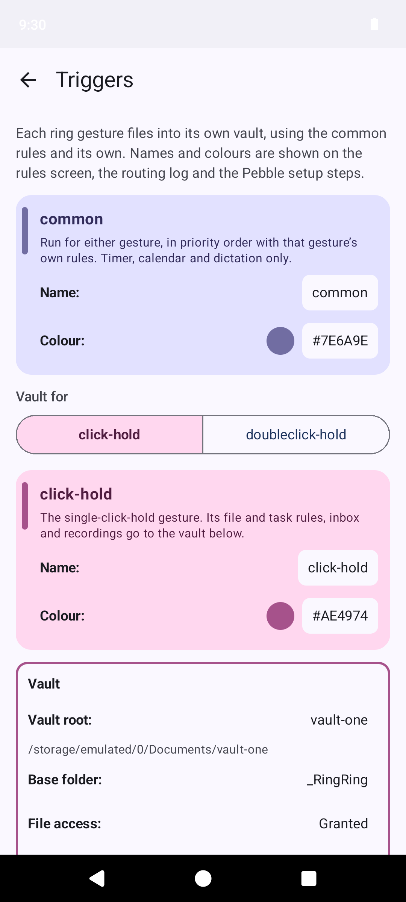 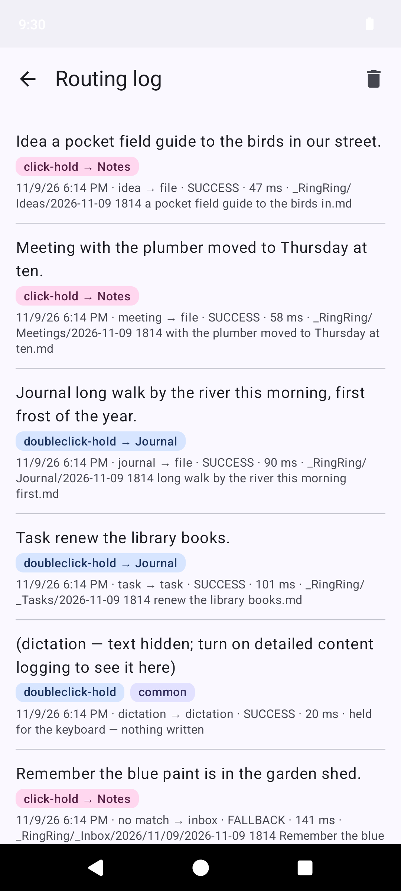

## What it can do with a recording

Each rule in the routing table pairs one or more keywords with an action:

| Action | What happens |
|---|---|
| **File** | A new note in a folder of your vault, with tags, Dataview-friendly frontmatter, and the recording saved alongside it. |
| **Task** | A Tasks-plugin task, one file per task, pulled into your daily note by a query rather than written into it, so a capture never races your vault's sync. |
| **Timer** | Starts a timer through the standard Android `SET_TIMER` intent, labelled with what you said. |
| **Calendar** | Opens a new event, either built from the phrase or handed to a calendar app that can parse "lunch tomorrow at noon" itself. |
| **Dictation** | Writes nothing at all. The text waits, briefly, for your keyboard's mic key to type it into whatever field has focus. |

Anything that matches no rule still becomes a note in that gesture's inbox,
with a notification, so a recording is never lost silently.

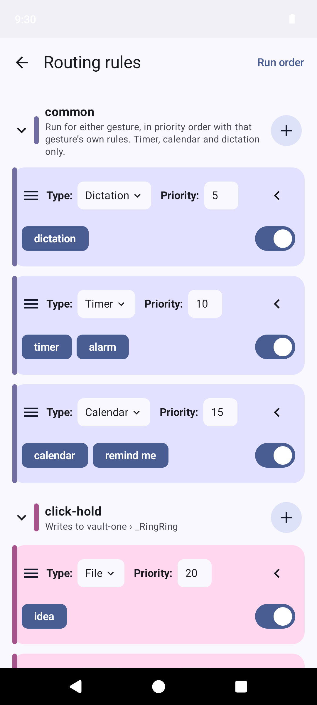 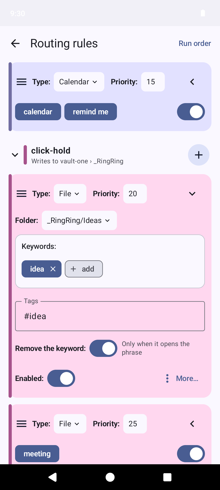 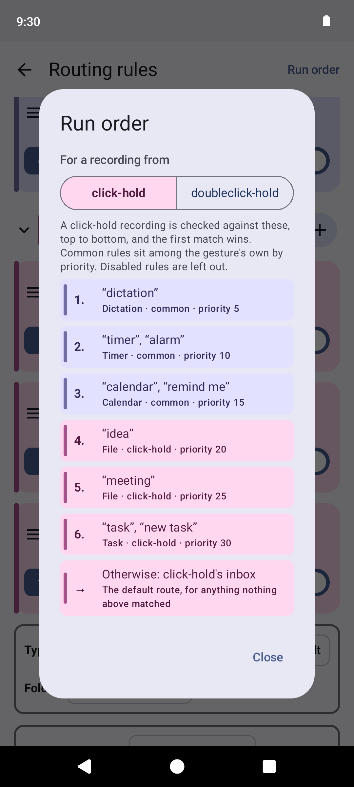

## Two gestures, one vault or two

Click-hold and double-click-hold each have **a name and a colour**, used on
the rules screen, the routing log, the Pebble setup steps and notifications,
so you can tell at a glance which gesture did what.

**One vault** is the default. Both gestures file into it, there is one list
of rules and one inbox, and any rule can be **limited to one gesture**: say
"idea" after a click-hold and it goes to `Ideas`, say it after a
double-click-hold and it goes to `Blog`.

**A vault per gesture** is a switch, the first item in Settings. Turned on,
each gesture files into its own vault, with its own file and task rules and
its own inbox. Timer, calendar and dictation rules need no vault, so they stay
**common** to both, and can still be limited to one gesture. Turning the
switch on or off walks through which vault is kept and where the rules go,
and deletes nothing in either vault.

**Run order** on the rules screen shows exactly which rules a recording from
either gesture is checked against, and in what order, using the same code
that does the routing.

A recording is never written to a vault its gesture does not file into. If
that vault cannot be reached, nothing is written anywhere and the Pebble app
is asked to resend, so the recording arrives once the vault is back.

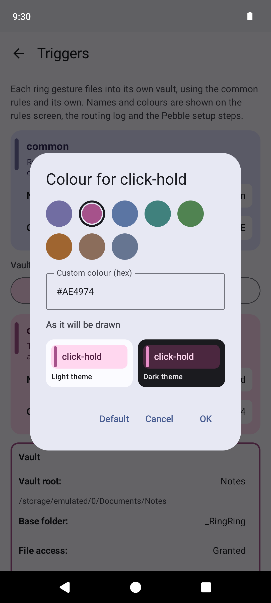 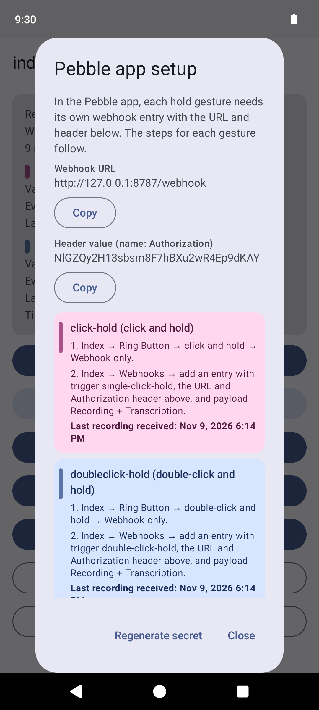

## Also

- **Each vault's rules live in that vault** as a Markdown file you can edit by
  hand. That file is also the backup: reinstall, choose the vault again, and
  the rules come back. **Sync now** reads a file changed elsewhere before
  anything is written over it.
- **Re-route** an item from the log if it landed in the wrong place. The file
  is moved and reformatted.
- **Keyword stripping**, per rule: "Task buy milk" files as *buy milk*.
- **Maps of Content** for each folder, generated on demand as live Dataview
  queries, with timestamped backups of anything they overwrite.
- **A routing log** of every recording and what happened to it. It keeps
  content for 2 hours by default and can be cleared.
- **Private by default.** Notifications name the gesture and the folder, but
  leave out what was said, and the note's file name, unless you turn on
  detailed content logging. The log does the same for dictations.
- **A notification channel per route**, so each can have its own sound.

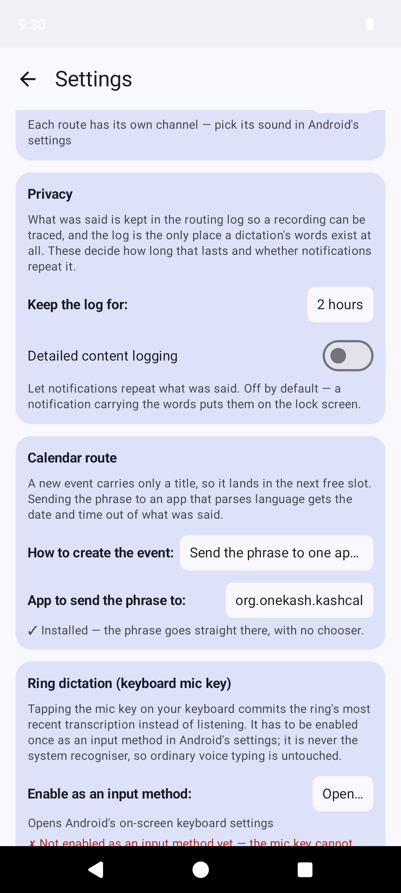

### Light and dark

Gesture colours are adjusted for each theme, so they stay readable whichever
you use and sit with your wallpaper's colours where Android provides them.

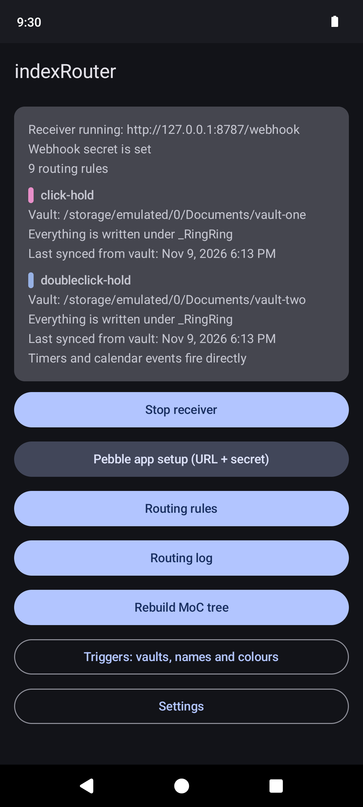 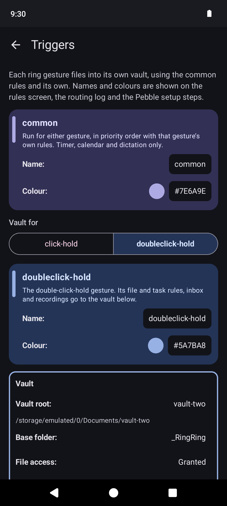 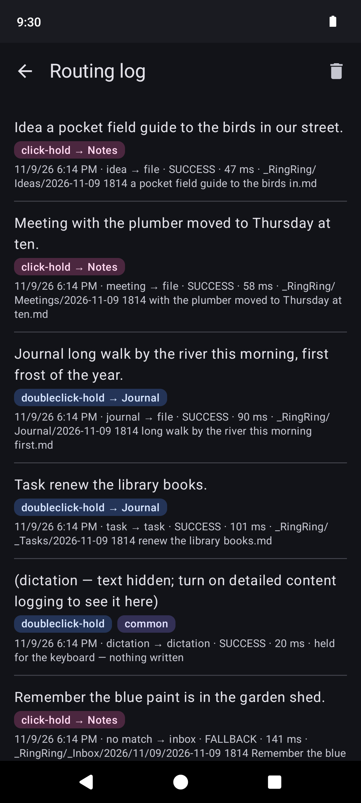

## Requirements

- Android 10 or later.
- A **Pebble Index 01** and the Pebble app, with its webhook feature.
- An **Obsidian vault** in ordinary shared storage, not Obsidian's app-private
  folder. Two, if you want each gesture to file into its own.
- Optional: a clock app that handles `SET_TIMER`, a calendar app, and a
  keyboard whose mic key can switch to another voice input method (HeliBoard
  does).

## Install

### With Obtainium (recommended)

Tap **Get it on Obtainium** above on your phone, or add this repository as an
app source by hand:

```
https://github.com/snrkl-labs/indexRouter
```

Each release carries exactly one APK, so no filter is needed. Obtainium then
offers each new release as an update. Test builds are published as
pre-releases; Obtainium ignores them unless you turn on **Include
prereleases** for the app.

### By hand

Download the APK from the [latest release](https://github.com/snrkl-labs/indexRouter/releases/latest).

### Verifying the download

Releases are signed with this certificate:

```
SHA-256: 16:EB:02:C8:4A:DC:E3:14:81:D1:D1:B3:82:E9:D4:D6:EA:82:02:38:D9:D5:71:3B:9B:39:44:49:CA:8B:29:40
```

Check it with `apksigner verify --print-certs indexrouter-vX.Y.Z.apk`. Each
release also lists the APK's own SHA-256.

**Upgrading from a build before 0.17.0:** those were debug-signed, and Android
will not update across signing keys. Uninstall the old build first.

## Setup

1. **Generate a webhook secret** in the app. It is stored encrypted under an
   Android Keystore key, and shown in **Pebble app setup** so you can copy it.
2. **Choose a vault.** Open **Vaults & gestures**, then choose the vault and
   the folder inside it the app writes into (`_RingRing` by default; it may be
   nested, such as `Inbox/_RingRing`). The checklist below shows the folders
   your rules need. Name and colour each gesture here too, if you like. For a
   vault per gesture, turn on **A vault per gesture** in Settings and choose
   the second gesture's vault the same way.
3. **In the Pebble app**, follow the steps **Pebble app setup** shows for
   whichever gestures you want to use: set the ring button gesture to *Webhook only*, then add a webhook
   entry with that gesture as its trigger, `http://127.0.0.1:8787/webhook` as
   the URL, an `Authorization` header with the secret as its value, and
   *Recording + Transcription* as the payload. The dialog then shows when each
   gesture last sent a recording, so a missing entry is easy to spot.
4. **On GrapheneOS**, grant both apps the Network permission: it governs
   loopback traffic too. If you use Storage Scopes, grant the vault folders
   there; otherwise the app reads files that other apps wrote in the vault,
   such as files changed by sync, through the permission given when you chose
   the vault.
5. **For timers and calendar events to fire directly**, grant "Display over
   other apps". Without it, Android blocks the app starting them from the
   background, and each one arrives as a notification to tap.
6. **For ring dictation**, set up your keyboard's mic key as described in
   [Ring dictation](#ring-dictation).

Then edit the routing rules to suit, and check **Run order** to see how they
combine.

## Ring dictation

A recording that starts with your dictation keyword ("dictation" by default)
is not filed anywhere. indexRouter holds the text, and the next time you tap
your keyboard's mic key it types that text into whatever field has focus. This
works with any keyboard whose mic key switches to another voice input method.
The steps here use [HeliBoard](https://github.com/HeliBorg/HeliBoard).

1. **Install HeliBoard** and make it your keyboard.
2. **Enable indexRouter as an input method.** In indexRouter, open
   **Settings → Ring dictation → Enable as an input method**, which takes you
   to Android's on-screen keyboard list, and turn on *indexRouter — Ring
   dictation*. Android warns that any input method could read what you type.
   indexRouter's has no keys: it only types the dictation you sent from the
   ring, then hands straight back to your keyboard.
3. **Check it is reachable.** Back in **Settings → Ring dictation**, the app
   should say *The mic key will reach this*. If it names another app instead,
   that app's voice input is ahead of indexRouter's. Turn it off in the same
   keyboard list.
4. **Keep HeliBoard's mic key in view.** The mic is on HeliBoard's toolbar by
   default. To stop suggestions hiding it, open HeliBoard's settings →
   **Toolbar → Select pinned toolbar keys** and turn on **Voice input**.
5. **Use it.** Say "dictation" and your text on the ring. Then tap a text
   field and tap the mic. The text appears, and HeliBoard comes back.

A dictation is offered for 10 minutes by default (**Dictation age cutoff**),
so an old one is never typed by accident. Its text is kept only in the routing
log, and the log hides it unless detailed content logging is on.

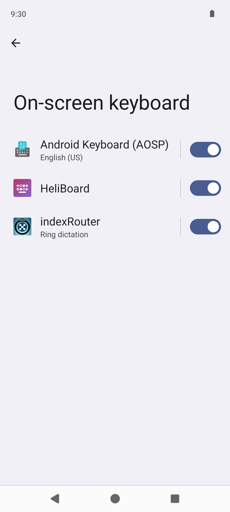 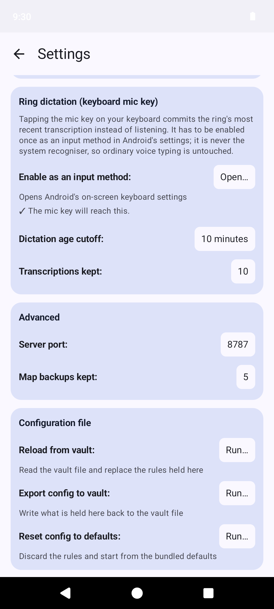 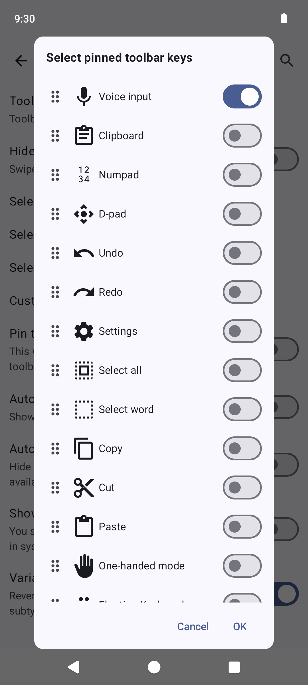

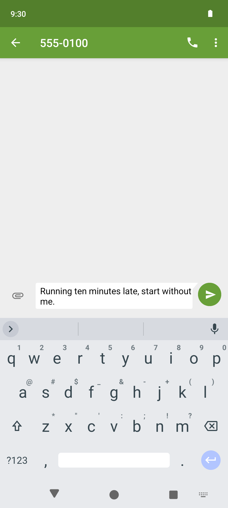

## Build from source

```bash
cd android
./gradlew assembleDebug          # debug build
./gradlew testDebugUnitTest      # unit tests, no device needed
./gradlew assembleRelease        # unsigned release APK
```

Identity is confined to two values, so a fork can rename the app in one small
change: `indexrouter.applicationId` in `android/gradle.properties` and
`app_name` in `android/app/src/main/res/values/strings.xml`.

## License

Copyright © snrkl-labs. Licensed under the
[GNU General Public License v3.0 or later](LICENSE).

The "Get it on Obtainium" badge is from the
[Obtainium](https://github.com/ImranR98/Obtainium) project.
